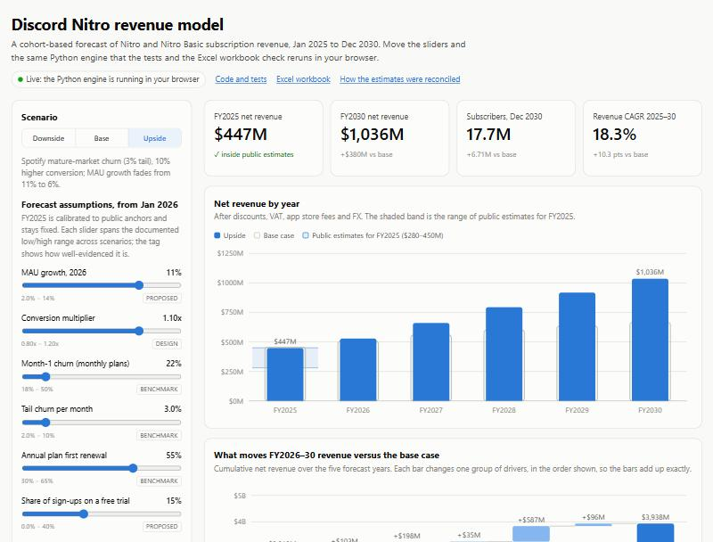

# Discord Nitro Subscription Revenue Model

A cohort-based, driver-level forecast of Discord Nitro and Nitro Basic revenue: monthly from Jan 2025 to Dec 2030, built up as subscribers × ARPU × FX, by plan, platform and region.

**[Live model →](https://jasperwang183-ux.github.io/discord-nitro-revenue-model/)** Pick a scenario, move the assumptions, and the same Python engine the tests check reruns in your browser. **[Exec memo →](docs/exec_memo.md)**

[](https://jasperwang183-ux.github.io/discord-nitro-revenue-model/)

> **Every Discord figure here is a third-party estimate.** Discord is private and has published no financial statements. This is an independent portfolio project, not affiliated with or endorsed by Discord, and it is about method rather than a precise estimate. See [docs/reconciliation.md](docs/reconciliation.md) for where each estimate comes from and how conflicting estimates were reconciled.

## Headline
| | FY2025 | FY2030 | FY2026–30 total |
|---|---|---|---|
| Downside | $447M | $393M | $2.15B |
| **Base** | **$447M** | **$656M** | **$2.92B** |
| Upside | $447M | $1.04B | $3.94B |

Net revenue: after VAT, discounts, app store fees and FX.

- **FY2025 reconciles.** It is calibrated to the 7.3M-subscriber estimate and lands inside the $280–450M range of public estimates. Only a Basic-heavy plan mix could explain the low end.
- **Retention is the largest driver** of the gap between scenarios.
- **Price is the largest single lever:** +10% is worth ~$290M over five years if volume holds, and breaks even at a ~14% conversion loss.
- **Reactivation is the third most sensitive input and has no public source.** That's the first data gap to close.

## How it works
1. **Sign-ups:** MAU × a conversion rate by region × plan mix (Nitro / Basic, monthly / annual). Some sign-ups start on a free trial.
2. **Cohorts:** each month's sign-ups decay along a survival curve. Monthly plans lose 30%, 14% and 9% in months 1–3, then 5% a month. Annual plans keep everyone for 12 months, then 45% renew.
3. **Reactivation:** 1.5% of the last 24 months' churners return each month, on a monthly plan.
4. **Revenue:** paying subscribers × net price × FX.
   - **Net price** starts from list and applies regional pricing, discounts, VAT and app store fees. Apple takes 30% in a subscriber's first year and 15% after, so the fee drops when each cohort ages past 12 months.
   - **FX:** prices are fixed in local currency, so exchange rates move USD revenue. FY2025 is priced at average rates; rates then move to the Oct 2026 spot and follow interest-rate-parity forwards, with a ±10% USD shock.
5. **Calibration:** only one number is fitted, a conversion scalar, so subscribers hit the 7.3M anchor in Jun 2025. Churn comes from peer benchmarks. Revenue is checked against the public range, never tuned to it.
6. **Scenarios:** FY2025 is fixed history. From Jan 2026, downside / base / upside change growth, conversion, trials, churn and reactivation for new sign-ups. An experiment toggle reads a hypothetical test result (conversion, churn, price) into the forecast. A driver bridge and a sensitivity chart show what moves the total.

## One engine, checked three ways
- **The engine:** [`src/nitro_model/cohorts.py`](src/nitro_model/cohorts.py). It is numpy-only, so the website runs this exact file in the browser through Pyodide.
- **The workbook:** [`outputs/Nitro_Revenue_Model.xlsx`](outputs/Nitro_Revenue_Model.xlsx), plus `_upside` and `_downside` versions. Every cell is a formula generated from the same assumptions and traces back to the Assumptions sheet. `Cohort_US_NitroM` lays one segment out as a full cohort triangle.
- **The tests:** [`tests/`](tests/) holds 86 tests. CI runs them all before each deploy. They check that:
  - subscribers roll forward every month (opening + new + reactivated − churned = closing)
  - cohorts tie to the total
  - **the workbook matches Python to the dollar** in every month and segment, in every scenario and with the experiment on
  - calibration hits the anchor and FY2025 history is identical across scenarios
  - every assumption has a source and date

## Repo map
| Path | What |
|---|---|
| [`docs/exec_memo.md`](docs/exec_memo.md) | One-page summary and recommendation |
| [`docs/reconciliation.md`](docs/reconciliation.md) | How conflicting public estimates were reconciled; calibration order; scenario design and sensitivity |
| [`data/assumptions.csv`](data/assumptions.csv) | Every input with value, range, status, source and date |
| [`data/sources.csv`](data/sources.csv) | Sources and how reliable each one is |
| [`docs/review_queue.md`](docs/review_queue.md) | Assumptions still marked `proposed` (judgment calls awaiting a source) |
| [`outputs/`](outputs/) | Workbooks per scenario; monthly forecast, scenario table, bridge and sensitivity CSVs |
| [`docs/ai_error_log.md`](docs/ai_error_log.md) | Log of errors caught in Claude Code's drafts |
| [`site/`](site/) | The website (static; deployed to GitHub Pages by CI) |

## Run it
```bash
python -m venv .venv
.venv/Scripts/python -m pip install -r requirements.txt -e .   # Windows; use .venv/bin/python on macOS/Linux
.venv/Scripts/python -m pytest -q
.venv/Scripts/python -m nitro_model.run                        # workbooks, CSVs, website data
.venv/Scripts/python -m http.server 8765 --directory site      # then open http://localhost:8765
```

## How it was built
I wrote the spec and the data schema, and I own every assumption and check. Claude Code drafted the code, the first-pass assumptions and this documentation. I reviewed each milestone before merging it, and [`docs/ai_error_log.md`](docs/ai_error_log.md) is where I record the errors I caught in its drafts.
